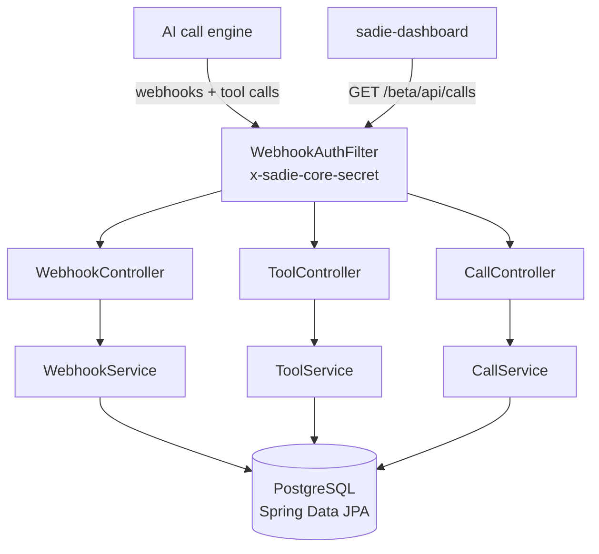

# SADIE Webhook Receiver

A Spring Boot service that receives AI phone-assistant webhook events, serves the assistant's tool calls, and stores every call, transcript, and tool invocation in PostgreSQL.

An AI voice assistant generates events throughout each call: the call starts, the assistant calls tools during the conversation, and an end-of-call report arrives at the finish. Those events can show up out of order or more than once. This backend accepts them behind a shared-secret check, processes them idempotently, links tool calls to their session even when the tool calls arrive first, and exposes read endpoints for the [sadie-dashboard](https://github.com/ChadiChoker/sadie-dashboard) frontend.

**Frontend:** [sadie-dashboard](https://github.com/ChadiChoker/sadie-dashboard)

## Features

- **Webhook events**:
  - `assistant-request` opens a call session with status `IN_PROGRESS`.
  - `end-of-call-report` completes the session and stores the transcript, summary, recording URL, category, ended reason, durations, timestamps, and per-message transcript entries.
- **Idempotent ingestion**: `call_id` is unique in the database, the service checks for an existing `call_id` before inserting, and a concurrent duplicate insert is treated as a no-op.
- **Defensive end-of-call handling**: if no session exists yet when the end-of-call report arrives, one is created.
- **Assistant tool endpoints**: `search-availability` and `create-reservation` return structured responses with `success`, `data`, `description`, and `steps` fields. The `steps` field gives the assistant instructions for what to say next.
- **Tool call audit log**: every tool request and response is stored as PostgreSQL `JSONB`.
- **Retroactive linking**: tool logs that arrive before the end-of-call report are attached to the session once the report comes in.
- **No 5xx from tool endpoints**: tool logic is wrapped in try/catch, so failures come back as structured error payloads instead of server errors.
- **Shared-secret auth**: a servlet filter requires `x-sadie-core-secret` on every `/beta/api/**` route and returns `401` when the header is missing or wrong.
- **Schema migrations**: Flyway manages the schema, and Hibernate validates it against the entities at startup (`ddl-auto=validate`).

> Tool responses are hardcoded mock data. No external APIs or real reservation systems are called.

## Tech Stack

| Technology | Version |
|---|---|
| Java | 17 |
| Spring Boot | 3.5.11 (Web, Data JPA, Validation) |
| PostgreSQL | 15 |
| Flyway | managed by Spring Boot |
| Lombok | managed by Spring Boot |
| Maven | 3.9+ (wrapper included) |

## Architecture



```
src/main/java/com/sadie/sadie_webhook_backend/
├── config/        # WebhookAuthFilter (secret header), WebConfig (CORS for localhost:5173)
├── controller/    # WebhookController, ToolController, CallController
├── service/       # Interfaces + impl/ (Webhook, Tool, Call)
├── repository/    # Spring Data JPA repositories
├── entity/        # CallSession, CallMessage, ToolCallLog, CallStatus enum
├── dto/           # webhook/, tool/, api/ request and response DTOs
└── exception/     # GlobalExceptionHandler
```

### Database schema

Flyway migrations (`src/main/resources/db/migration`) create three tables:

<details>
<summary><code>call_sessions</code>: one row per phone call</summary>

| Column | Type | Description |
|---|---|---|
| id | UUID | Primary key |
| tenant_id | VARCHAR | Tenant identifier (defaults to `default`) |
| call_id | VARCHAR (UNIQUE) | Call identifier from the call engine |
| assistant_id | VARCHAR | AI assistant ID |
| customer_number | VARCHAR | Caller's phone number |
| dealership_number | VARCHAR | Business phone number |
| status | VARCHAR | `IN_PROGRESS` or `COMPLETED` |
| transcript | TEXT | Full call transcript |
| summary | TEXT | AI-generated call summary |
| recording_url | TEXT | URL of the call recording |
| duration_seconds | NUMERIC | Call duration in seconds |
| duration_minutes | NUMERIC | Call duration in minutes |
| category | VARCHAR | e.g. `BOOKING`, `CANCELLATION`, `INQUIRY` |
| ended_reason | VARCHAR | How the call ended |
| started_at / ended_at | TIMESTAMPTZ | Call start and end |
| created_at / updated_at | TIMESTAMPTZ | Row timestamps |

</details>

<details>
<summary><code>call_messages</code>: transcript messages linked to a session</summary>

| Column | Type | Description |
|---|---|---|
| id | UUID | Primary key |
| session_id | UUID (FK) | References `call_sessions`, cascade delete |
| tenant_id | VARCHAR | Tenant identifier |
| role | VARCHAR | `bot` or `user` |
| message | TEXT | Message content |
| time / end_time | NUMERIC | Absolute start and end timestamps (ms) |
| seconds_from_start | NUMERIC | Offset from call start |
| duration | NUMERIC | Message duration (ms) |
| created_at / updated_at | TIMESTAMPTZ | Row timestamps |

</details>

<details>
<summary><code>tool_call_logs</code>: audit log of every tool call</summary>

| Column | Type | Description |
|---|---|---|
| id | UUID | Primary key |
| session_id | UUID (FK, nullable) | References `call_sessions`, set null on delete |
| tenant_id | VARCHAR | Tenant identifier |
| tool_name | VARCHAR | `search-availability` or `create-reservation` |
| call_id | VARCHAR | Call identifier |
| request_json | JSONB | Raw incoming request payload |
| response_json | JSONB | Response returned |
| created_at / updated_at | TIMESTAMPTZ | Row timestamps |

</details>

## API Overview

Every endpoint requires the header `x-sadie-core-secret: <secret>`.

| Method | Path | Purpose |
|---|---|---|
| `POST` | `/beta/api/sadie/webhook` | Handle `assistant-request` and `end-of-call-report` events |
| `POST` | `/beta/api/sadie/tools/search-availability` | Return mock vehicle availability and log the call |
| `POST` | `/beta/api/sadie/tools/create-reservation` | Return a mock reservation confirmation and log the call |
| `GET` | `/beta/api/calls` | List all call sessions, newest first |
| `GET` | `/beta/api/calls/{callId}` | Session detail, plus `messages` ordered by `secondsFromStart` and `toolLogs` ordered by `createdAt` |

### Webhook payloads

**`assistant-request`**: sent when a call begins. A duplicate `call_id` is ignored.

```json
{
  "type": "assistant-request",
  "call_id": "...",
  "tenant_id": "...",
  "customer_number": "+1...",
  "restaurant_number": "+1...",
  "assistant_id": "..."
}
```

**`end-of-call-report`**: sent when a call ends. It marks the session `COMPLETED`, saves the messages, and links any orphaned tool logs.

```json
{
  "type": "end-of-call-report",
  "call_id": "...",
  "transcript": "...",
  "summary": "...",
  "category": "BOOKING",
  "ended_reason": "assistant-ended-call",
  "messages": [...]
}
```

Optional fields: `recording_url`, `duration_seconds`, `duration_minutes`, `started_at`, `ended_at` (ISO-8601 with offset). An unknown `type` returns `{"success": false, "error": "Unknown event type: ..."}`.

### Tool payloads

```json
{
  "call_id": "...",
  "arguments": {
    "pickupDate": "2026-03-22T10:00:00",
    "returnDate": "2026-03-25T10:00:00",
    "pickupLocation": "Downtown",
    "driverAge": "28"
  }
}
```

- **search-availability** always returns three vehicle classes: Economy ($39/day, $117 total), Mid-Size ($59/day, $177 total), and SUV ($89/day, $267 total).
- **create-reservation** returns confirmation number `87430618`. If `firstName` or `lastName` is missing from `arguments`, it returns `success: false` with steps asking the assistant to collect the caller's name.
- Both endpoints always respond with HTTP 200.

## Getting Started

### Prerequisites

- Java 17
- Maven 3.9+ (or use the included `./mvnw`)
- PostgreSQL 15

### 1. Create the database

```bash
psql -U postgres -c "CREATE DATABASE sadie_db;"
```

The datasource is set in `src/main/resources/application.properties` as `jdbc:postgresql://localhost:5432/sadie_db`, with user `postgres` and an empty password. Adjust these values to match your setup.

### 2. Configure the secret

The app uses `test-secret` as the default shared secret for local development. To override it:

```bash
export SADIE_CLIENT_SERVER_SECRET=your-secret-here
```

### 3. Run

```bash
mvn spring-boot:run
# or
./mvnw spring-boot:run
```

The app starts on `http://localhost:8080`. Flyway runs all migrations automatically at startup.

### Tests

```bash
./mvnw test
```

The included test is a Spring context-load test, so it needs the database to be reachable.

### Try it

```bash
curl -X POST http://localhost:8080/beta/api/sadie/webhook \
  -H "Content-Type: application/json" \
  -H "x-sadie-core-secret: test-secret" \
  -d '{"type":"assistant-request","call_id":"call_1","tenant_id":"t1","customer_number":"+15550001111"}'

curl http://localhost:8080/beta/api/calls -H "x-sadie-core-secret: test-secret"
```

## Design Decisions

- **Idempotency in two layers**: the database enforces a `UNIQUE` constraint on `call_id`, and the service checks `existsByCallId` first so duplicates don't throw exceptions.
- **No 5xx from tool endpoints**: the tool service catches its own errors and `GlobalExceptionHandler` acts as a final safety net. The voice assistant always gets a response it can act on.
- **Retroactive tool log linking**: tool calls can arrive before the end-of-call report. When the report comes in, orphaned logs (`call_id = ? AND session_id IS NULL`) are linked to the session.
- **JSONB audit log**: request and response payloads are stored as PostgreSQL `JSONB`, which keeps them queryable.

---

Built by [Chadi Choker](https://github.com/ChadiChoker) · [Portfolio](https://github.com/ChadiChoker/portfolio)
